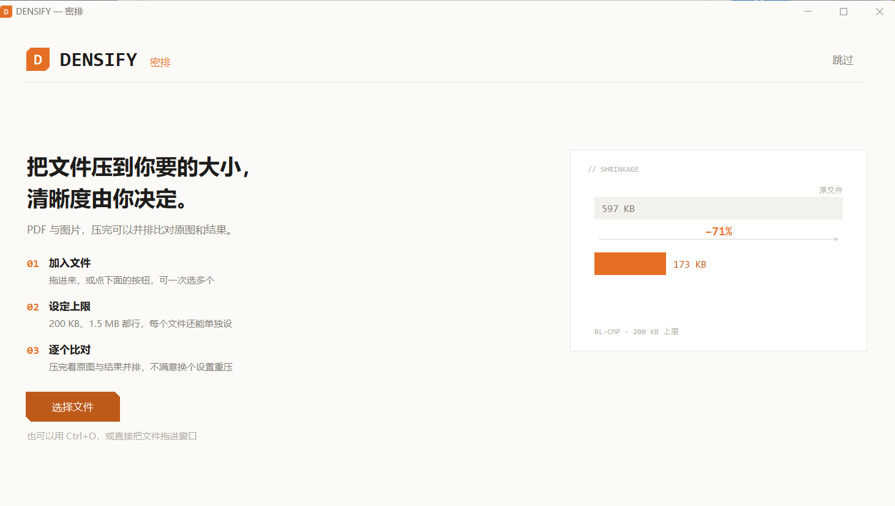
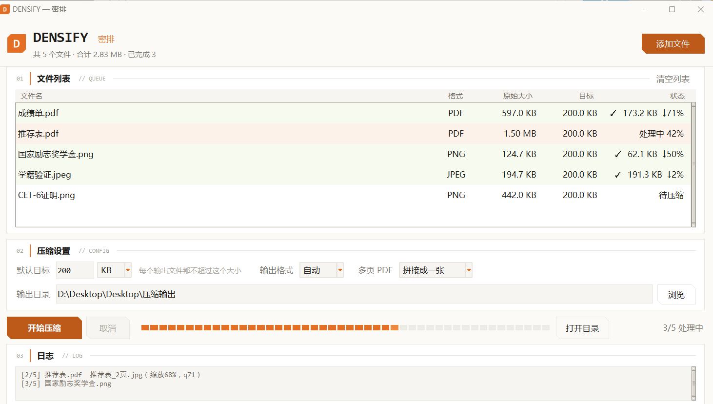

<div align="center">

# DENSIFY · 密排

**把 PDF 和图片压到你指定的大小，压完能并排比对原图。**

[](LICENSE)


</div>



## 为什么做这个

多数压缩工具是"一键压缩"：你不知道会压成什么样，也不知道能不能更小。

DENSIFY 反过来——你指定目标体积（比如 200 KB），它负责在不超过这个体积的前提下，
尽可能多保留清晰度。压完双击一行，原图和结果并排放在一起，差多少一眼能看出来。

写这个工具的直接原因：报名系统和招聘网站常卡 200 KB，而一页 A4 成绩单直接导出是 600 KB。

## 下载

- **开箱即用**：到 [Releases](../../releases) 下载 `DENSIFY.exe`，双击运行。不需要装 Python。
- **源码运行**：见下方「开发」。

## 特性

| 能力 | 说明 |
|---|---|
| 指定目标体积 | 200 KB、1.5 MB 都行，每个输出文件都不超标 |
| 每个文件单独设 | 双击「目标」列，让这份压 200 KB、那份压 300 KB |
| 压完可对比 | 双击任意一行，原图与结果并排，附减小比例 |
| 自动选格式 | 同一文件同时试 jpg 和 png，取保留像素更多的那种 |
| 多页 PDF | 拼接成一张长图，或逐页输出 |
| 可中止 | 压到一半能停，已完成的不丢 |
| 全本地 | 不联网，不上传任何文件 |



## 用法

1. 点右上角「添加文件」，或按 `Ctrl+O`
2. 填默认目标，选输出格式
3. 点「开始压缩」

**快捷键**

| 键 | 作用 |
|---|---|
| `Ctrl+O` | 添加文件 |
| `Ctrl+Enter` | 开始压缩 |
| `Delete` | 移除选中的文件 |
| `Esc` | 关闭欢迎页 |

**右键**：文件上右键可看对比、设目标、移除；列表空白处右键可添加文件夹。
点了右上角的图标能重新打开欢迎页。

## 支持格式

- 输入：PDF、jpg、jpeg、png、bmp、webp、tif、tiff
- 输出：jpg、png、pdf

## 它是怎么压的

不是简单调低 JPEG 质量，而是分层搜索：

1. **先保分辨率**：按原尺寸试最高可用质量，压不下来才逐级缩小，不轻易牺牲像素
2. **格式分工**：文字和表格走 PNG 调色板量化（256 → 16 色阶梯），照片走 JPEG 质量二分
3. **自动格式**：两种都编码一遍，比较各自的缩放比例，取保留像素更多的那个
4. **留余量**：目标乘 0.985，避免"200KB"按 200000 还是 204800 算的口径差异
5. **PDF 三级降级**：无损优化 → 内嵌图重压 → 整页转图（第三步会丢文字层，日志里会写明）

一个实测对比：一页 A4 密集表格压到 200 KB，PNG 256 色量化后 173 KB，文字仍然锐利；
同一张图走 JPEG 要 320 KB 以上才勉强能看。这类页面适合 PNG，而扫描件和照片正相反。

## 开发

需要 Python 3.10+，且该 Python 自带 tkinter（Windows 官方安装包和 Anaconda 都有）。

```bash
pip install -r requirements.txt
python gui.py
```

跑测试：

```bash
python tests/test_core.py     # 核心压缩逻辑，16 项
python tests/test_gui.py      # 界面交互，15 项
```

打包 exe：

```bash
pyinstaller --noconfirm --onefile --windowed --icon icon.ico ^
  --name DENSIFY --add-data "icon.ico;." gui.py
```

## 项目结构

```
core.py        压缩算法，不依赖界面，可单独调用
gui.py         tkinter 界面
icon.ico       图标
tests/         验收测试
docs/          截图
```

`core.py` 可以脱离界面单独使用：

```python
import core

# 压到 200KB 以内，输出 jpg，多页 PDF 拼成一张
results = core.compress_one(
    "input.pdf", "output/", 200_000, "jpg",
    merge_pages=True, log=print,
)

for r in results:
    print(r.path, r.size, r.fmt)
```

## 许可

[MIT](LICENSE)

图标与界面图形均为程序绘制，未使用任何第三方素材。
